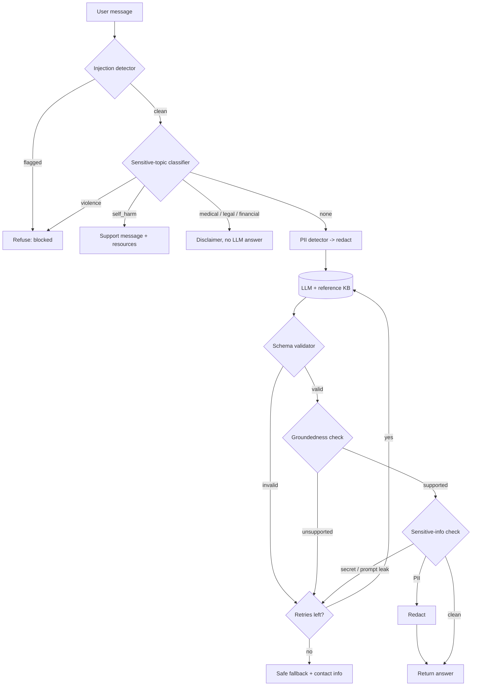

# Architecture

Order rationale: injection runs first (cheapest, and a hijacked request must never reach topic logic or the LLM);
topics next (some need a special response, not an LLM answer); PII redaction last on input so the LLM never sees raw PII.
On output, schema comes first because the later checks need parsed fields; groundedness before sensitive-info so
we don't spend effort redacting an answer that will be discarded. Secrets/prompt leaks are never "redacted and sent" - they trigger regeneration/fallback.
